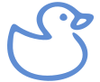

# RDCore.SDK.Protocols
<sup>_Ce document est disponible en [français](./README.fr.md)_</sup>


## Before we begin.
> 👋 Hi! New here? _Rubberduck_ was always an open-source initiative. **RDCore honors it with an Open-Core formula**.  
> <small>See [rubberduckvba.ca](https://rubberduckvba.ca) for more information.</small>

This repository holds the [**RDCore.SDK.Protocols**](https://www.nuget.org/packages/RDCore.SDK.Protocols) package of the [RDCore](https://github.com/rubberduck-vba/RDCore) platform, licensed under **⚖️MIT**. It is what a client of the platform needs and nothing else: the `rdcore/*` methods and their messages, the platform handshake, how to start the language server, and the files of the languages the platform serves. It uses the .NET base library only, with no OmniSharp. HexIDE's RDCore add-in references it.

The [RDCore.SDK](https://github.com/rubberduck-vba/RDCore.SDK) package, the language model and the plumbing every platform component shares, depends on this one. The platform built on them, the RD-VBA runtime included, lives in the [RDCore](https://github.com/rubberduck-vba/RDCore) repository, under **⚖️GPLv3 or later**. What you build with RDCore is yours (see [RDCore's NOTICE](https://github.com/rubberduck-vba/RDCore/blob/main/NOTICE.md)).

The MIT license in [LICENSE](LICENSE) covers the library of this repository. A French version of the license is available on request. [NOTICE.md](NOTICE.md) is the library's notice.

## 📊 Project Status
This library is in **alpha**: its API will still change before 1.0.

**Contributions**  

- Individuals: ✅ Open ([CLA](CLA.md))  
- Corporate: ⏳ Planned  

[](https://www.nuget.org/packages/RDCore.SDK.Protocols)
[](https://github.com/rubberduck-vba/RDCore.SDK.Protocols/actions/workflows/build.yml)
[](https://github.com/rubberduck-vba/RDCore.SDK.Protocols/actions/workflows/build.yml)

## Building

From the repository root, with the .NET 11 SDK:

```
dotnet build RDCore.SDK.Protocols.slnx
dotnet test RDCore.SDK.Protocols.slnx
```

---
### See also
- [The API reference](https://rubberduck-vba.github.io/RDCore.SDK.Protocols/api/RDCore.SDK.html)
- [RDCore.SDK](https://github.com/rubberduck-vba/RDCore.SDK)
- [RDCore](https://github.com/rubberduck-vba/RDCore)
- [CONTRIBUTING.md](CONTRIBUTING.md)
- [CODE_OF_CONDUCT.md](CODE_OF_CONDUCT.md)
- [RD-VBAL](https://rubberduck-vba.github.io/RDCore/specs/rd-vbal.1.0.introduction.html)

<hr/>
<p align='left' style='margin-left: 32px;'>
<a href='https://rubberduck-vba.github.io/RDCore/index.fr.html'>ACCUEIL</a> • <a href='https://rubberduck-vba.github.io/RDCore/index.html'>HOME</a>  | ℹ️ <a href='https://rubberduck-vba.github.io/RDCore/introduction.fr.html'>BIENVENUE</a> • <a href='https://rubberduck-vba.github.io/RDCore/introduction.html'>WELCOME</a>  | 🧩 <a href='https://rubberduck-vba.github.io/RDCore/getting-started.fr.html'>BÂTISSONS</a> • <a href='https://rubberduck-vba.github.io/RDCore/getting-started.html'>BUILD</a>  | <a href='https://rubberduck-vba.github.io/RDCore/specs/rd-vbal.html'><strong>RD-VBAL</strong></a>  |  <a href='https://rubberduck-vba.github.io/RDCore.SDK/api/RDCore.SDK.html'>SDK</a>  | 🌐 <a href='https://rubberduckvba.ca'>rubberduckvba.ca</a>
</p>
<hr/>
<p align='center'></p>
<h6 align='center'>V I V A T ❤️ C U C U M I S ™</h6>
<p align='center' style='font-size:8pt;'>
<small>© Copyright <strong>9562-7303 Québec inc.</strong> (2026)<br/><em>Seul, &quot;Rubberduck&quot; est utilisé pour fins de référence au projet open-source legacy <strong>utilisé publiquement ainsi depuis 2015</strong> et sans lien ni affiliation avec tout tiers détenteur d'une marque semblable dans quelque juridiction que ce soit.<br/>&quot;Rubberduck VBA&quot;, &quot;RDCore&quot; et &quot;VIVAT CUCUMIS&quot; sont des marques de commerce revendiquées par 9562-7303 Québec inc. (en attente); Toutes les marques appartiennent à leur détenteur respectif.<br/>RDCore n'est pas un produit de Microsoft et n'est pas affilié à Microsoft, ni directement, ni indirectement.<br/><br/>If used alone, <em>&quot;Rubberduck&quot; is used as a reference to the legacy open-source project <strong>the same way it has been used publicly since 2015</strong> and without any links or affiliation with any third-party trademark holders of a similar trademark in any jurdisdiction.<br/>&quot;Rubberduck VBA&quot;, &quot;RDCore&quot; and &quot;VIVAT CUCUMIS&quot; are trademarks claimed by 9562-7303 Québec inc. (pending). All trademarks belong to their respective owners.<br/>RDCore is not a Microsoft product and is not affiliated with Microsoft, directly or indirectly.</small>
</p>

